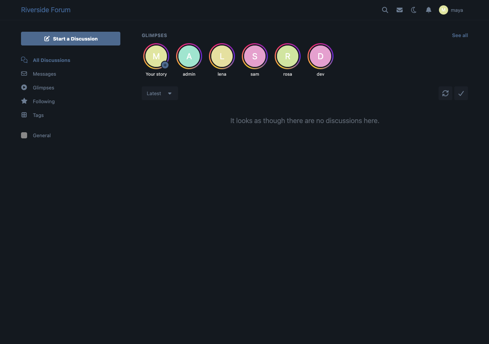
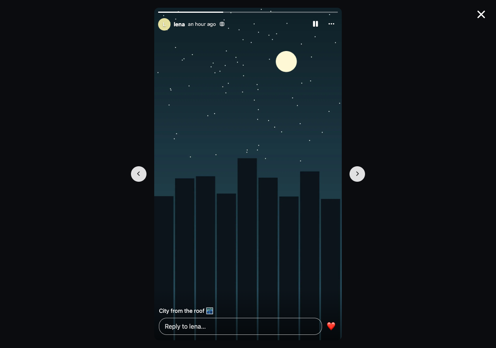
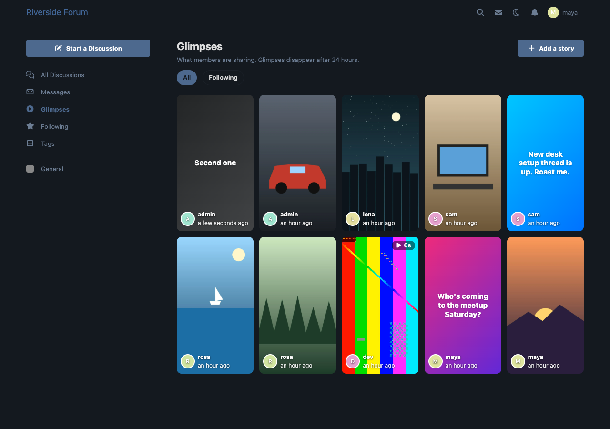
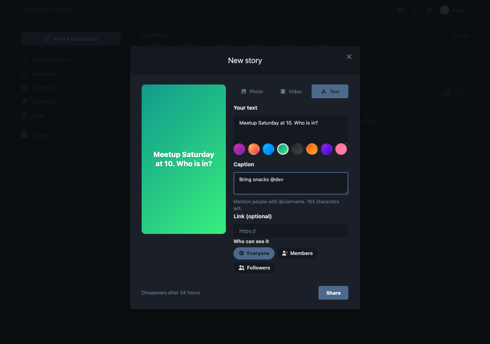

# Glimpse

Stories for Flarum 2, called Glimpses on your forum: short photo, video and text posts that disappear after a day, shown as a row of avatar rings above the discussion list and played full screen.

 [](https://packagist.org/packages/ernestdefoe/glimpse)



- **Post a story.** A photo, a short video, or a few words on one of eight colors. Add a caption (mention people with @username), one link, and pick who can see it: everyone, signed-in members, or your followers (with [Follow Users](https://github.com/imorland/follow-users)). It disappears after 24 hours; the admin can pick 6, 12, 48 hours or a week.
- **The bar.** New stories first, people you follow next, then the newest. Seen rings turn grey. Your own ring comes first, with a plus to add another.
- **The viewer.** Full screen on phones, a 9:16 card on desktop. Tap the right side to go on, the left to go back, hold to pause, swipe down to close, swipe sideways to move to the next person. Arrow keys, Space and Esc work too. Progress bars run along the top, videos play for their length, and the next story loads while you watch.
- **React and reply.** Quick reactions (choose up to eight emoji, or just one for a single like button). Replies go to the author privately, through [Parley](https://ernestdefoe.online/downloads/f/parley) or Flarum's own Messages.
- **Seen by.** Only the author (and moderators) can see who saw a story and how they reacted.
- **Highlights.** Keep stories past their time in named collections on your profile.
- **The Glimpses page** at `/glimpse` lists every live story you can see, with a Following filter. Each profile has a Glimpses tab.
- **Moderation.** Report a story; moderators see reports and waiting stories at `/glimpse/queue`, and can hide or delete any story. Hold new members' stories for approval by post count, days since joining, or a [Trust Levels](https://ernestdefoe.online/downloads/f/trust-levels) level. Anyone can mute a person's stories. Suspended members' stories disappear while the suspension lasts, and with [FoF Ignore Users](https://github.com/FriendsOfFlarum/ignore-users) a member's stories can be hidden from the people they ignore.
- **Widgets.** The story bar in [Bespoke](https://ernestdefoe.online/downloads/f/bespoke)'s zones, as a [Page Builder](https://ernestdefoe.online/downloads/f/page-builder) block and in [FoF Widgets](https://github.com/FriendsOfFlarum/forum-widgets-core).
- **Also post to Moments.** With [Moments](https://ernestdefoe.online/downloads/f/moments), a photo or video story can be posted there too.







## Private and safe

- One visibility rule decides every read: the bar, the page, profiles, highlights, notifications and the media files themselves. Photos and videos are served only to people who may see the story, never cached by shared caches, and gone when the story is.
- Uploads are checked by their content, never their name or the type the browser claims. Photos are saved again on the server, which removes location, camera details and anything hidden in the file. Videos keep their picture but lose their metadata, including the location phones record. No SVG, no HTML, nothing a browser would run.
- A flood guard spaces out posts, and the admin sets a daily limit.

## Light

The bar is one request, and costs the same few queries for one person or thirty. The viewer, the create sheet and the pages load only when opened. Expired stories and unused uploads are deleted every hour with their files (`php flarum glimpse:prune`, scheduled; Flarum's scheduler must be running).

## Install

```sh
composer require ernestdefoe/glimpse
```

Uploads are stored in `storage/glimpse`. Make sure your web server allows uploads as large as your largest video (`client_max_body_size` in nginx, `upload_max_filesize` and `post_max_size` in PHP).

## Update

```sh
composer update ernestdefoe/glimpse
php flarum migrate
php flarum cache:clear
```

## Links

- [Packagist](https://packagist.org/packages/ernestdefoe/glimpse)
- [GitHub](https://github.com/ernestdefoe/glimpse)
- [Buy me a coffee](https://buymeacoffee.com/ernestdefoe)
